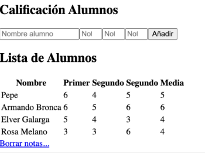
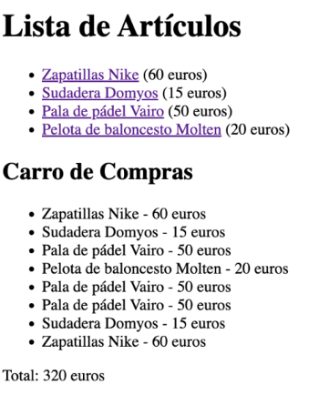

# Tema 4

## Ejercicio 1:

Realizar una aplicación que compruebe si existe la cookie “user” tiene datos, vuestro
nombre, en caso de estar vacia que la cree con una caducidad de 1000. En la siguiente
ejecución debe de aparecer vuetros nombre en el navegador.

### Resultado:

## Ejercicio 2:

• preferencias.php con un formulario que le pida al usuario su nombre y su color
favorito (a elegir de una lista desplegable, o con el control input type=”color” de
HTML5). El formulario deberá enviarse a guarda_prefs.php.

• guarda_prefs.php que recogerá los datos del formulario anterior, y los guardará
en dos cookies llamadas nombreusu y colorusu, con 5 minutos de duración. Esta
página redirigirá (con header) a la página index.php una vez almacenadas las
cookies.

• index.php que, si hay cookies guardadas del usuario, mostrará una página con el
color de fondo preferido y un mensaje personalizado de bienvenida (por ejemplo,
“Bienvenido, Pepe”). Si no hay cookies guardadas, mostrará una página confondo
blanco y el mensaje “Página de inicio”. En cualquiera de los dos casos, habrá un
enlace para ir al formulario preferencias.php.

• Añade una página borrar_prefs.php que elimine las preferencias (cookies) del
usuario actual, y redirija a index.php. Pon un enlace "Borrar preferencias
" en el index.php que llame a esta página, pero que se muestre sólo cuando el
usuario actual tenga preferencias guardadas.

### Resultado:

## Ejercicio 3:

Crear una pequeña aplicación que permita la gestión académica del módulo de DWES.
Interesa almacenar las notas de cada trimestre y mostrar un informe con las notas la
media y el nombre de los alumnos. Tambiés debe haber un botón/enlace para borrar
los datos.



### Resultado:

## Ejercicio 4:

Crea una carpeta login en la carpeta de ejercicios. Dentro vamos a crear un pequeño sistema de login y uso de sesiones. Crea los siguientes archivos:

• usuarios.txt donde vamos a guardar varios logins y passwords de prueba, sepa-
rados por “:”, uno por fila, como en este ejemplo:

```
usu1:pass1
usu2:pass2
prueba:passprueba
```

• cabecera.inc que hará lo siguiente:
– Comprobará si existe en sesión un atributo llamado loginusu. Si no existe,
redirigirá a la página login.php que haremos después. Si existe, sacará un
menú de enlaces a las páginas pag1.php y pag2.php

• Crea las páginas index.php, pag1.php y pag2.php que incluyan la cabecera anterior (con require), y como contenido, ponles simplemente un mensaje de bienvenida diferente para cada página (para identificarlas).

• Finalmente, la página de login.php tendrá un formulario para pedirle al usuario su login y password, y se llamará a sí misma. Los datos que reciba del formulario, los comparará con los del fichero usuarios.txt para ver si coincide con alguno. Si coincide, creará un atributo loginusu en sesión con el login del usuario y redirigirá a index.php. Si no coincide con ninguno, se volverá a cargar el propio formulario, con un mensaje de error en rojo indicando que el login o la contraseña son incorrectos.

### Resultado:

## Ejercicio 5:

Crea una carpeta llamada carro con una página llamada carro.php con una lista de enlaces de diferentes artículos y su precio. Por ejemplo:

```
Zapatillas Nike (60 euros)
Sudadera Domyos (15 euros)
Pala de pádel Vairo (50 euros)
Pelota de baloncesto Molten (20 euros)
```

Puedes alimentar la lista desde un array de artículos previamente definido en PHP, como este:

```
$articulos = array(
array("id" => 1, "nombre" => "Zapatillas Nike", "precio" => 60),
array("id" => 2, "nombre" => "Sudadera Domyos", "precio" => 15),
array("id" => 3, "nombre" => "Pala de pádel Vairo", "precio" =>
50),
array("id" => 4, "nombre" => "Pelota de baloncesto Molten", "
precio"
=> 20)
);
```

Cada vez que el usuario haga clic en un artículo, se enviará a la propia página, recogerá el código o id del artículo (que se le enviará como parámetro) y con ello buscará el artículo en el catálogo y acumulará en sesión el total de lo que ha ido comprando, junto con un listado de los artículos que ha seleccionado, para mostrarlo todo por pantalla. Por ejemplo:



### Resultado: