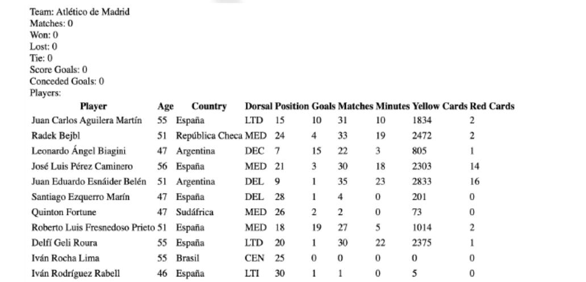

# Tema 5

## Ejercicio 1:

Clases.php

Crea una página llamada clases.php con:

    • Una clase llamada Persona que tenga como atributos un DNI, un nombre y un email.

        – Crea un constructor que permita rellenar esos tres atributos, y los getters y setters correspondientes.

        – Define también un método Mostrar para sacar por la página los datos de la persona (en un párrafo, separados por guiones).

        – Define adecuadamente la visibilidad (pública o privada) de cada atributo o método.

    • Crea una segunda clase llamada Estudiante que:

        – Herede de Persona, y añada un atributo llamado numExpediente.

        – Crea su constructor, sus getters y setters y su correspondiente método Mostrar.

Fuera de las clases, entre el código HTML de la página, crea un objeto de cada tipo (una Persona
y un Estudiante), con los valores que quieras, llama después a algún setter de cada una para
cambiar el valor de algún atributo, y finalmente llama a sus métodos Mostrar para que saquen
la información de cada uno.

### Resultado:

## Ejercicio 2:

Player.php
Crea las siguientes clases:

| Clase  | Campos | Métodos |
|--------|--------|---------|
| **Player** | Name, BirthDay, Country, Dorsal, Position, Goals, Matches, Minutes, YellowCard, RedCard | `Construct()`, `Age()`, `Score()`, `AddCard(int Colour)`, `PlayMinutes(int min)`, `Render()` |
| **Team** | Name, Players, Matches, Won, Lost, Tie, ScoreGoals, ConcededGoals | `Construct()`, `Render()`, `SignPlayer(Player)` |

Importa el fichero y cargalo el Team de l’Atletic de Madrit y muestra la plantilla en pantalla
utilitzando la función render de la classe Team.

### Resultado: